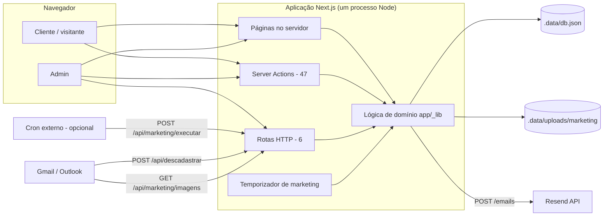
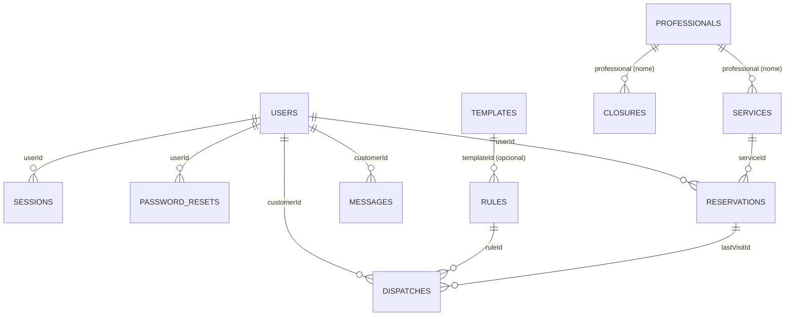
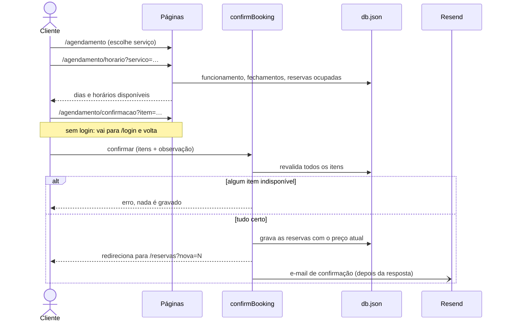
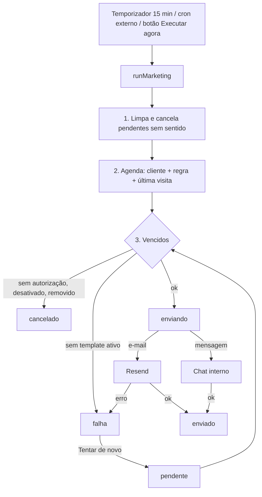

# Mapeamento de sistemas — Studio Heitor Macks (SHM)

**Data do levantamento:** 2026-11-10
**Base analisada:** branch `main`, commit `d0b1d77`, mais três arquivos com mudanças locais ainda sem commit (`app/page.tsx`, `app/_components/sidebar.tsx`, `app/_components/client-home.tsx`).
**Escopo:** levantamento, análise e documentação. Nenhum código foi alterado e nenhuma API foi criada.
**Método:** leitura do código-fonte e da estrutura do banco local (somente nomes de campos, sem valores). O aplicativo não foi executado nem testado nesta etapa.

> Este documento substitui o `API_DIAGNOSTICO.md` (de 2026-11-05) como retrato do sistema. Aquele arquivo ficou desatualizado em pontos importantes; a seção 10 lista quais.

---

## 1. Resumo

1. **Existe um único sistema**: uma aplicação web monolítica (Next.js) que reúne o site de agendamento do cliente e o painel administrativo do estúdio. Não há outros serviços, bancos ou repositórios neste diretório.
2. **Quase toda a lógica é interna ao Next.js**: 47 Server Actions fazem as gravações e as páginas leem o banco direto no servidor. Só existem 6 rotas HTTP, todas de apoio (exportar CSV, imagens, cron, descadastro).
3. **O banco é um arquivo JSON** (`.data/db.json`), sem transações, índices nem restrições. É o maior impedimento para produção e para qualquer API pública.
4. **Disponibilidade pela ocupação real** (desde 2026-11-11): o cliente vê todos os horários livres. Antes, um sorteio do protótipo mostrava só cerca de 1 em cada 6.
5. **Cancelar guarda a reserva como "cancelada"** (desde 2026-11-11), com quem cancelou, quando e o motivo. Antes, a reserva era apagada.
6. **Integração externa real, só uma**: Resend (envio de e-mail). Pagamento, WhatsApp/SMS e calendário externo não existem.

---

## 2. Inventário

### 2.1 Sistemas

| Sistema | Tipo | Onde está | Situação |
|---|---|---|---|
| SHM | Aplicação web monolítica (cliente + admin) | este repositório | Em desenvolvimento, roda localmente |

Serviço externo usado: **Resend** (e-mail). Repositório remoto: `github.com/vagnerzezo/shm`.

### 2.2 Módulos

| # | Módulo | Público | Telas | Lógica (`app/_lib/`) |
|---|---|---|---|---|
| 1 | Autenticação e sessão | todos | `/login`, `/esqueci-senha`, `/redefinir-senha` | `auth.ts`, `actions.ts`, `account-actions.ts`, `password-reset.ts`, `password.ts` |
| 2 | Conta do cliente | cliente | `/conta` | `actions.ts`, `account-actions.ts`, `profile.ts` |
| 3 | Agendamento (carrinho) | visitante e cliente | `/agendamento`, `/agendamento/horario`, `/agendamento/confirmacao` | `availability.ts`, `booking.ts`, `schedule.ts`, `reservations.ts` |
| 4 | Reservas do cliente | cliente | `/reservas`, `/reservas/[id]/remarcar` | `reservations.ts`, `actions.ts`, `account-actions.ts` |
| 5 | Chat | cliente e admin | `/mensagens`, `/admin/chat` | `chat.ts`, `chat-format.ts`, `actions.ts` |
| 6 | Início | cliente e admin | `/`, `/admin` | leituras diretas |
| 7 | Agenda do estúdio | admin | `/admin/agenda`, `/admin/agenda/nova` | `agenda.ts`, `reservation-actions.ts` |
| 8 | Clientes | admin | `/admin/clientes`, `/novo`, `/[id]` | `customers.ts`, `customer-actions.ts` |
| 9 | Histórico e faturamento | admin | `/admin/historico` | `history.ts`, `csv.ts` |
| 10 | Catálogo (serviços e profissionais) | admin | `/admin/servicos` | `catalog.ts`, `services.ts`, `catalog-actions.ts` |
| 11 | Configurações | admin | `/admin/configuracoes` | `settings-actions.ts`, `schedule.ts`, `studio.ts` |
| 12 | Marketing | admin | `/admin/marketing` e subpáginas | `marketing.ts`, `marketing-actions.ts`, `marketing-template.ts`, `marketing-scheduler.ts`, `marketing-images.ts` |
| 13 | E-mail | interno | prévia em Marketing > Templates | `email.ts`, `email-html.ts`, `email-templates/*` |
| 14 | Descadastro | público (por link) | `/descadastrar` | `unsubscribe.ts` |
| 15 | Perfil do admin | admin | `/admin/perfil` | `admin-profile-actions.ts` |
| 16 | Persistência | interno | — | `db.ts` |

### 2.3 Subsistemas de apoio

- **Agendador interno**: `instrumentation.ts` liga um temporizador (`marketing-scheduler.ts`) que roda o motor de marketing 30 s após o servidor subir e depois a cada 15 min (`MARKETING_INTERVAL_MINUTES`).
- **Scripts**: `scripts/criar-contas-teste.mjs` (cria contas de teste e grava as senhas em `.data/contas-teste.txt`) e `scripts/gerar-icones-email.mjs` (gera os PNG de `public/img/email/`).
- **Componentes de interface**: `app/_components/` (moldura do painel, menu, toasts, chat, filtros) e `components/ui/` (shadcn).

---

## 3. Arquitetura

### 3.1 Tecnologias

| Camada | Tecnologia | Versão |
|---|---|---|
| Framework | Next.js (App Router, Server Components, Server Actions) | 16.3.6 |
| Interface | React | 19.2.8 |
| Linguagem | TypeScript | 5.x |
| Estilo | Tailwind CSS 4, `tw-animate-css`, shadcn, `@base-ui/react`, `lucide-react` | — |
| Execução | Node.js (testado localmente com 22) | — |
| Banco | Arquivo JSON em disco | — |
| E-mail | Resend, por chamada HTTP direta (sem SDK) | — |
| Senhas | `scrypt` do Node (`node:crypto`) | — |
| Qualidade | ESLint 9 | — |

Não há testes automatizados, CI, Docker, `middleware`/`proxy`, ORM, nem biblioteca de validação (as validações são escritas à mão em cada action).

### 3.2 Visão geral



### 3.3 Estrutura de pastas

```
app/
  page.tsx                 Início (visitante: vitrine; cliente logado: painel; admin: vai para /admin)
  login/ esqueci-senha/ redefinir-senha/ descadastrar/    telas públicas
  (painel)/                área do cliente: agendamento, reservas, mensagens, conta
  admin/                   painel do estúdio
  api/                     6 rotas HTTP
  _lib/                    domínio, banco, e-mail, Server Actions
  _components/             componentes compartilhados
components/ui/             componentes shadcn
scripts/                   utilitários de linha de comando
public/img/                logo, fundo do login, ícones dos e-mails
.data/                     banco e uploads (fora do git)
```

### 3.4 Padrões usados no código

- **Leitura**: a página (Server Component) chama funções de `_lib` que leem o JSON inteiro e filtram em memória.
- **Gravação**: formulário → Server Action → validação → `updateDb()` → `redirect()` ou `refresh()`.
- **Aviso após gravar**: a action redireciona para `?aviso=<chave>` e a tela mostra um toast (`notices.ts`).
- **Estado na URL**: carrinho (`?item=`), filtros, paginação e visão da agenda viajam como parâmetros.
- **Atualização "ao vivo"**: o chat recarrega a página a cada 5 s enquanto a aba está visível (`AutoRefresh`). Não há WebSocket nem SSE.
- **E-mails depois da resposta**: os avisos transacionais saem com `after()`, sem atrasar a ação do usuário; falha de envio só vai para o log.

### 3.5 Variáveis de ambiente

| Variável | Uso | Obrigatória |
|---|---|---|
| `ADMIN_EMAILS` | E-mails que entram como admin (além de quem tem `role: "admin"` no banco) | não |
| `RESEND_API_KEY` | Chave do Resend | para enviar e-mail |
| `MARKETING_EMAIL_FROM` | Remetente de todos os e-mails (marketing e sistema) | para enviar e-mail |
| `APP_URL` | Endereço público usado nos links dos e-mails (padrão `http://localhost:3000`) | em produção |
| `CRON_SECRET` | Protege `POST /api/marketing/executar` | só com cron externo |
| `MARKETING_INTERVAL_MINUTES` | Intervalo do temporizador interno (padrão 15) | não |
| `EMAIL_LOGO_URL` | Logo alternativo nos e-mails do sistema | não |

`MARKETING_INTERVAL_MINUTES` e `EMAIL_LOGO_URL` são usadas no código mas não constam no `.env.example`.

---

## 4. Funcionalidades e regras de negócio

### 4.1 Autenticação e perfis

- Dois perfis: `cliente` (padrão) e `admin`. É admin quem tem `role: "admin"` no banco **ou** cujo e-mail está em `ADMIN_EMAILS`.
- Senha com `scrypt` e salt por usuário, guardada como `salt:hash`.
- Sessão: token aleatório de 32 bytes em cookie `shm_sessao` (HttpOnly, SameSite=Lax, Secure em produção), válido por 30 dias. O token fica gravado em texto puro no banco.
- Conta desativada perde o acesso na hora, mesmo com sessão aberta.
- Login devolve a mesma mensagem para e-mail inexistente e senha errada.
- Depois do login: admin vai para `/admin`, cliente para `/reservas`, ou para o `next` informado (só caminhos internos).
- **Esqueci a senha**: link por e-mail, uso único, vale 1 hora, no máximo 3 pedidos por hora por conta; o banco guarda só o hash do código. Ao trocar, todas as sessões são encerradas. Sem Resend configurado, o link aparece só no terminal do servidor.
- **Trocar senha**: exige a senha atual; encerra as outras sessões.
- Senha: 8 a 100 caracteres. No cadastro, o limite máximo não é verificado (só o mínimo).
- Não há limite de tentativas de login, confirmação de e-mail, nem segundo fator.

### 4.2 Cadastro e dados do cliente

- Campos: nome (mín. 2), WhatsApp (10 ou 11 dígitos), e-mail (único, até 120 caracteres), senha, e duas autorizações de marketing (e-mail e mensagem).
- O cliente pode editar seus dados e autorizações em `/conta`.
- **Excluir a própria conta (LGPD)**: pede a senha e a palavra `EXCLUIR`; apaga usuário, sessões, reservas, mensagens, envios de marketing e pedidos de senha. Não tem volta. Admin não pode se excluir por aí.

### 4.3 Catálogo

- **Serviço**: id (derivado do nome), nome (2–80, único), categoria (2–40), profissional (opcional), duração (5–480 min, múltiplos de 5), preço em centavos (0 a R$ 10.000), ativo/inativo.
- **Profissional**: nome (2–40, único) e cor. **Não tem id**: o nome é a chave. Renomear atualiza os serviços e os fechamentos ligados a ele.
- Serviço sem profissional = "qualquer profissional do estúdio".
- Enquanto o admin não altera nada, vale o catálogo padrão que está no código (9 serviços, 2 profissionais). A primeira alteração copia tudo para o banco.
- Serviço com reservas não é apagado, só desativado. Profissional com serviços não pode ser apagado.
- **Preço histórico**: cada reserva grava o preço do momento. Ao mudar o preço de um serviço, as reservas antigas sem preço gravado recebem o valor anterior.

### 4.4 Funcionamento e fechamentos

- Configuração única do estúdio: dias da semana abertos, horário de abertura, último horário de início, intervalo entre horários (15/20/30/45/60 min), janela máxima de agendamento (1–365 dias) e antecedência mínima (0–72 h).
- Padrão: segunda, quarta a sábado, 10:00 a 19:00, de 15 em 15 min, até 90 dias à frente.
- Não há horário diferente por dia da semana, intervalo de almoço, nem horário por profissional.
- **Fechamento**: período (até 1 ano) com motivo, do estúdio todo ou de um profissional. A tela avisa quais reservas existentes caem no período, mas não as cancela.
- Fuso fixo: `America/Sao_Paulo`. Datas trafegam como `AAAA-MM-DD` e horas como `HH:MM`.

### 4.5 Disponibilidade (lado do cliente)

Um horário é oferecido ao cliente quando **todas** as condições valem:

1. o dia está entre hoje e a janela máxima;
2. o dia é de funcionamento e não está em fechamento (do estúdio ou do profissional do serviço);
3. o horário respeita a antecedência mínima, se for hoje;
4. não bate com outra reserva do mesmo cliente (qualquer serviço);
5. algum profissional que faz o serviço está livre e sem fechamento nesse intervalo: o profissional fixo do serviço ou, num serviço sem profissional fixo, qualquer um do estúdio.

Toda reserva guarda quem atende (`professional`). Num serviço sem profissional fixo, ele é escolhido na marcação: o livre com menos atendimentos no dia. Na remarcação, continua o mesmo se estiver livre. Reservas antigas sem `professional` usam o do serviço; as de serviço sem profissional fixo ocupam "um lugar" entre os livres, sem saber qual. Reservas canceladas não ocupam horário. Regras em `availability.ts` (`getSlots`, `freeProfessionals`, `pickProfessional`).

### 4.6 Agendamento pelo cliente

- Fluxo em três passos: escolher serviço → escolher dia e horário → confirmar. Dá para juntar vários serviços num carrinho, que viaja na URL (`?item=<serviço>_<data>_<hora>`).
- Visitante navega e monta o carrinho sem login; o login é pedido só na confirmação.
- Ao confirmar, o servidor refaz toda a validação. Se algum item não vale mais, nada é gravado.
- Observação opcional de até 300 caracteres, repetida em todas as reservas do carrinho.
- Pagamento: só "pagar no dia", presencial.
- Dispara e-mail de confirmação (um e-mail para o carrinho inteiro).

### 4.7 Reservas

- **Situação é calculada, não gravada**: `agendado` (ainda não passou), `realizado` (passou e não foi marcado como falta) ou `faltou` (admin marcou).
- **Cancelar** (cliente): só reservas futuras e próprias. A reserva fica com situação **cancelada** (`cancelledAt`, `cancelledBy`), sai da lista do cliente e libera o horário. Dispara e-mail de cancelamento.
- **Remarcar** (cliente): só reservas futuras, para um horário disponível do mesmo serviço. Avisa o estúdio por mensagem automática no chat. Não envia e-mail.
- Não há prazo mínimo para cancelar ou remarcar, nem limite de reservas por cliente.

### 4.8 Agenda do estúdio

- Visões dia, semana e mês; cores por profissional; linha da hora atual.
- **Criar reserva** para um cliente (ativo) em qualquer horário, desde que o dia não esteja fechado e haja um profissional livre (o do serviço ou, sem fixo, qualquer um, escolhido como no item 4.5). Não se aplicam a janela, a antecedência nem o horário de funcionamento. Pode ser em data passada. Marca `createdBy: "admin"`.
- **Remarcar** e **cancelar** (com motivo opcional de até 200 caracteres).
- Em cada operação, o admin escolhe se avisa o cliente. Ao avisar: mensagem no chat e, em criação e cancelamento, também e-mail. Remarcação avisa só pelo chat.
- **Compareceu / faltou**: só depois do horário. Falta não entra no faturamento nem conta como visita.

Diferença a registrar: no lado do cliente, uma reserva dele bloqueia qualquer outro serviço no mesmo intervalo; no lado do admin, o conflito é verificado só por profissional.

### 4.9 Clientes (admin)

- Lista com busca (nome, e-mail, telefone), filtros (com horário marcado, sem visita há 30+ dias, nunca vieram, com faltas, desativados), ordenação e paginação de 25.
- Números por cliente: visitas, faltas, total gasto, última visita, próximo horário.
- Cadastrar cliente (com senha definida pelo admin), editar dados e observação interna (até 1000 caracteres), definir nova senha, desativar/reativar, excluir dados (LGPD, exige digitar `EXCLUIR`).
- Desativar encerra as sessões; reservas e histórico ficam.
- Exportação em CSV.

### 4.10 Histórico e faturamento

- Todas as reservas, com filtros (busca, cliente, profissional, situação, período) e paginação de 25.
- Resumo: total, clientes distintos, realizados, faltas e faturamento (só realizados, pelo preço gravado na reserva).
- Exportação em CSV com os mesmos filtros.
- Tudo é calculado em memória, a cada acesso, percorrendo todas as reservas.

### 4.11 Chat

- Uma conversa por cliente, entre ele e "o estúdio" (qualquer admin). Texto puro, até 2000 caracteres.
- Contador de não lidas dos dois lados; abrir a conversa marca como lida.
- Mensagens automáticas entram na mesma conversa: avisos de reserva criados pelo admin, remarcação feita pelo cliente e marketing do canal "mensagem".
- Sem anexos, sem notificação por e-mail ou push quando chega mensagem.

### 4.12 Marketing (reativação de clientes)

- Dois canais, ligados e desligados separadamente: **e-mail** (Resend) e **mensagem** (hoje, apenas o chat interno; não é WhatsApp nem SMS).
- **Template**: nome, canal, assunto (e-mail), conteúdo, ativo, padrão do canal (um por canal). E-mail aceita HTML de um editor visual, filtrado por lista de tags permitidas, com upload de imagens. Limites: 20.000 caracteres (e-mail) e 1.000 (mensagem).
- Variáveis: `{{nome}}`, `{{primeiro_nome}}`, `{{ultima_visita}}`, `{{dias_sem_visita}}`, `{{ultimo_servico}}`, `{{profissional}}`, `{{link_agendamento}}`, `{{estudio}}`.
- **Regra**: "N dias (1–365) depois da última visita sem novo agendamento, enviar o template X". Sem template próprio, usa o padrão do canal.
- **Motor** (a cada execução):
  1. descarta pendentes que perderam o sentido (regra pausada ou alterada, canal desligado) e cancela os de quem marcou de novo;
  2. cria um envio pendente por cliente + regra + última visita (nunca repete a mesma combinação);
  3. envia os vencidos.
- Regras do motor:
  - só quem autorizou o canal recebe; admin e contas desativadas ficam de fora;
  - falta não conta como visita;
  - quem tem horário futuro não recebe;
  - nada retroativo: só vale para ausências que vencem depois de a regra ou o canal ser ligado;
  - várias regras do mesmo canal vencidas juntas: sai só a de maior prazo;
  - envio preso em "enviando" por mais de 10 min vira falha;
  - falha pode ser reenviada manualmente.
- Situações do envio: `pendente`, `enviando`, `enviado`, `falha`, `cancelado`.
- Teste de template para um e-mail qualquer; histórico com filtros; botão "executar agora".
- Descadastro: link no rodapé e cabeçalho `List-Unsubscribe` de um clique (RFC 8058). Desliga só o e-mail de marketing daquele cliente.

### 4.13 E-mails do sistema (transacionais)

Quatro modelos fixos em código, com layout próprio, que **não dependem** de autorização de marketing:

| Modelo | Quando sai |
|---|---|
| Boas-vindas | cadastro feito pelo próprio cliente |
| Agendamento realizado | cliente confirma o carrinho; admin cria reserva e marca "avisar" |
| Agendamento cancelado | cliente cancela; admin cancela reserva futura e marca "avisar" |
| Redefinição de senha | pedido em "esqueci minha senha" |

O admin vê a prévia e envia um teste em Marketing > Templates. Os textos não são editáveis pela tela. Imagens vão embutidas (cid) enquanto `APP_URL` não for https. Os e-mails de marketing ainda usam um rodapé simples, diferente desse layout.

Não saem por e-mail: remarcação (cliente ou admin), cadastro feito pelo admin, lembrete antes do horário, nova mensagem no chat.

---

## 5. Banco de dados

### 5.1 Como funciona hoje

- Um arquivo: `.data/db.json`. Cada leitura carrega o arquivo inteiro; cada gravação reescreve o arquivo inteiro.
- As gravações passam por uma fila em memória (`updateDb`), que evita sobreposição **dentro de um mesmo processo**.
- Imagens enviadas pelo editor ficam em `.data/uploads/marketing/`.
- A pasta `.data/` está fora do git. Não há rotina de backup nem migrações.

### 5.2 Entidades

| Coleção | Chave | Campos | Observações |
|---|---|---|---|
| `users` | `id` (UUID) | `name`, `phone`, `email`, `passwordHash`, `createdAt`, `role?`, `consent? {email, mensagem}`, `adminNote?`, `disabledAt?`, `unsubscribeToken?` | e-mail único (verificado no código) |
| `sessions` | `token` | `userId`, `expiresAt` | limpeza de expiradas a cada novo login |
| `passwordResets` | `tokenHash` | `userId`, `createdAt`, `expiresAt`, `usedAt?` | |
| `reservations` | `id` (UUID) | `userId`, `serviceId`, `date`, `time`, `note?`, `attendance?`, `priceCents?`, `createdBy?` | sem campo de situação nem de data de criação |
| `services` | `id` (slug) | `name`, `category`, `professional?` (nome), `durationMinutes`, `priceCents`, `active?` | ausente no banco = catálogo padrão do código |
| `professionals` | `name` | `color` | idem |
| `messages` | `id` (UUID) | `customerId`, `from` (`admin`/`cliente`), `text`, `createdAt`, `readAt?` | não registra qual admin escreveu |
| `templates` | `id` (UUID) | `name`, `channel`, `subject?`, `body`, `active`, `isDefault`, `createdAt`, `updatedAt` | |
| `rules` | `id` (UUID) | `channel`, `name`, `daysAfter`, `templateId` (ou nulo), `active`, `activeSince`, `createdAt` | |
| `dispatches` | `id` (UUID); `key` única | `customerId`, `channel`, `ruleId`, `ruleName`, `lastVisitId`, `lastVisitDate`, `dueDate`, `status`, `templateId?`, `templateName?`, `subject?`, `body?`, `reason?`, `sentAt?`, `createdAt`, `updatedAt` | guarda cópia do texto enviado |
| `closures` | `id` (UUID) | `start`, `end`, `professional?` (nome), `reason`, `createdAt` | |
| `schedule` | objeto único | `openWeekdays[]`, `openTime`, `lastStartTime`, `stepMinutes`, `maxDaysAhead`, `minNoticeMinutes` | |
| `marketing` | objeto único | `email {enabled, enabledSince?}`, `mensagem {…}`, `lastRunAt?` | |
| `studio` | objeto único | `name`, `address[]` (até 3 linhas), `phone`, `email?`, `social? {instagram, facebook, linkedin}` | ausente = padrão do código |

### 5.3 Relacionamentos



Nenhum desses vínculos é garantido pelo banco; a integridade depende do código de cada action.

### 5.4 Pontos de atenção para a migração

| Ponto | Consequência |
|---|---|
| Erro de leitura é tratado como "banco vazio" (`readDb`) | Se o arquivo estiver corrompido ou inacessível, a próxima gravação pode sobrescrever tudo com um banco quase vazio |
| Gravação direta no arquivo, sem arquivo temporário | Queda no meio da escrita pode corromper o JSON |
| Fila de escrita só em memória | Não protege com mais de um processo ou instância |
| Validação de horário fora da gravação | Duas confirmações simultâneas do mesmo horário podem passar (ver 9.1) |
| Profissional identificado pelo nome | Precisa virar entidade com id |
| Reserva sem `createdAt` | Não há auditoria de quando foi marcada (cancelamento já guarda `cancelledAt`) |
| Reserva não guarda nome nem duração do serviço | Mudar a duração de um serviço altera a leitura de reservas antigas |
| Token de sessão em texto puro | Vazamento do arquivo expõe sessões ativas |
| Datas em formatos mistos | `date`/`time` como texto local, `createdAt` em ISO UTC, `expiresAt` em milissegundos |
| Catálogo, estúdio e funcionamento com padrão no código | A migração precisa semear esses valores |

---

## 6. Integrações

### 6.1 Serviços externos

| Serviço | Direção | Como | Uso | Observações |
|---|---|---|---|---|
| Resend | saída | `POST https://api.resend.com/emails`, Bearer, `Idempotency-Key`, tempo limite de 15 s | Marketing e e-mails do sistema | Um só remetente. Não há recebimento de eventos (entrega, bounce, reclamação) |
| Clientes de e-mail (Gmail, Outlook) | entrada | `POST /api/descadastrar?t=` | Descadastro de um clique | Autenticado só pelo token do link |
| Cron externo (opcional) | entrada | `POST /api/marketing/executar` com `Authorization: Bearer <CRON_SECRET>` | Rodar o motor de marketing | Alternativa ao temporizador interno |
| Google Fonts | build | `next/font` (Inter) | Fonte da interface | — |

Não existem: pagamento, WhatsApp/SMS, calendário externo, analytics, monitoramento de erros, armazenamento de arquivos em nuvem.

### 6.2 Rotas HTTP existentes

| Método | Rota | Acesso | Entrada | Saída |
|---|---|---|---|---|
| GET | `/api/admin/exportar/clientes` | admin (cookie) | — | CSV (`;`, UTF-8 com BOM); 401 se não for admin |
| GET | `/api/admin/exportar/historico` | admin (cookie) | filtros do histórico na URL | CSV; 401 |
| POST | `/api/marketing/imagens` | admin (cookie) | `multipart`, campo `imagem`, até 5 MB, PNG/JPG/GIF/WebP (tipo conferido pelo conteúdo) | `{ url }`; 400, 401, 413, 415 |
| GET | `/api/marketing/imagens/[arquivo]` | público | nome `<uuid>.<ext>` | imagem com cache de 1 ano; 404 |
| POST | `/api/marketing/executar` | `CRON_SECRET` | — | `{ scheduled, cancelled, sent, failed }`; 401; 503 se o segredo não estiver configurado |
| POST | `/api/descadastrar` | público (token) | `?t=<token>` | 200 ou 404, sem corpo |

Não há padrão único de erro, versionamento, CORS, limite de requisições nem documentação OpenAPI.

### 6.3 Comunicação entre módulos

Tudo acontece por chamada de função dentro do mesmo processo. Os cruzamentos relevantes:

| De | Para | Motivo |
|---|---|---|
| Agendamento, Agenda | E-mail | confirmação e cancelamento |
| Agenda, Reservas do cliente | Chat | avisos automáticos de criação, remarcação e cancelamento |
| Marketing | Chat | entrega do canal "mensagem" |
| Marketing | Reservas, Catálogo, Estúdio | última visita, nome do serviço e do estúdio para as variáveis |
| Catálogo | Reservas, Fechamentos | congelar preço antigo; propagar renomeação de profissional |
| Clientes, Conta | todas as coleções | exclusão LGPD (`purgeUser`) |
| Configurações | Disponibilidade | funcionamento e fechamentos |

---

## 7. Fluxos de processo

### 7.1 Agendamento pelo cliente



### 7.2 Reserva criada pelo estúdio

Admin abre `/admin/agenda/nova` → escolhe cliente (ou cadastra um e volta), serviço, data e hora → o servidor confere dia fechado e conflito por profissional → grava com `createdBy: "admin"` → se "avisar" estiver marcado: mensagem no chat e e-mail de confirmação → volta para a agenda do dia.

### 7.3 Cancelamento e remarcação

| Quem | Operação | Efeito no banco | Chat | E-mail |
|---|---|---|---|---|
| Cliente | cancelar | marca como cancelada | — | cancelamento |
| Cliente | remarcar | troca data e hora | mensagem automática ao estúdio | — |
| Admin | cancelar | marca como cancelada (com motivo) | se "avisar" e a reserva for futura | se "avisar" e a reserva for futura |
| Admin | remarcar | troca data e hora | se "avisar" | — |

### 7.4 Ciclo do marketing



Salvar regra, ligar/desligar canal ou regra roda os passos 1 e 2 na hora, sem enviar.

### 7.5 Recuperação de senha

`/esqueci-senha` → gera o código, grava só o hash, envia o link (ou mostra no terminal, sem Resend) → `/redefinir-senha?token=…` → nova senha → marca o link como usado, encerra todas as sessões, abre uma nova e entra.

### 7.6 Descadastro de e-mail

Link do rodapé abre `/descadastrar?t=…` (mostra o e-mail parcialmente oculto) → botão confirma → `consent.email = false`. Ou o botão do próprio Gmail/Outlook faz `POST /api/descadastrar?t=…` direto.

### 7.7 Exclusão de dados (LGPD)

Pelo cliente (`/conta`, com senha + `EXCLUIR`) ou pelo admin (ficha do cliente, com `EXCLUIR`). Remove usuário, sessões, reservas, mensagens, envios de marketing e pedidos de senha. O faturamento histórico diminui, porque as reservas somem.

---

## 8. Inventário de operações (base para os contratos)

As 47 Server Actions são, na prática, a "API interna" de hoje. Campos entre parênteses são os nomes usados nos formulários.

### 8.1 Público e cliente

| Operação | Arquivo | Acesso | Entrada | Efeito |
|---|---|---|---|---|
| `signUp` | `actions.ts` | público | `nome`, `telefone`, `email`, `senha`, `aceita_email`, `aceita_mensagem`, `next` | cria usuário e sessão; e-mail de boas-vindas |
| `signIn` | `actions.ts` | público | `email`, `senha`, `next` | cria sessão |
| `signOut` | `actions.ts` | logado | — | apaga a sessão |
| `requestPasswordReset` | `account-actions.ts` | público | `email` | cria link e envia |
| `resetPassword` | `account-actions.ts` | público (token) | `token`, `senha`, `confirmacao` | troca a senha, encerra sessões, entra |
| `unsubscribe` | `account-actions.ts` | público (token) | `t` | desliga e-mail de marketing |
| `confirmBooking` | `actions.ts` | cliente | `item[]`, `observacao` | cria reservas; e-mail |
| `cancelReservation` | `actions.ts` | cliente (dono) | `id` | marca reserva futura como cancelada; e-mail |
| `rescheduleMyReservation` | `account-actions.ts` | cliente (dono) | `id`, `data`, `hora` | troca data e hora; mensagem no chat |
| `updateProfile` | `actions.ts` | logado | dados do perfil | atualiza dados e autorizações |
| `changePassword` | `account-actions.ts` | logado | `atual`, `senha`, `confirmacao` | troca a senha |
| `deleteOwnAccount` | `account-actions.ts` | cliente | `senha`, `confirmacao` | exclusão LGPD |
| `sendCustomerMessage` | `actions.ts` | cliente | `texto` | nova mensagem |
| `markCustomerReadAction` | `actions.ts` | cliente | — | marca como lidas |

### 8.2 Admin

| Área | Operações | Arquivo |
|---|---|---|
| Agenda | `createReservationByAdmin`, `rescheduleReservation`, `cancelReservationByAdmin`, `setAttendance` | `reservation-actions.ts` |
| Clientes | `createCustomer`, `updateCustomer`, `setCustomerPassword`, `setCustomerActive`, `deleteCustomer` | `customer-actions.ts` |
| Catálogo | `saveService`, `toggleService`, `deleteService`, `saveProfessional`, `deleteProfessional` | `catalog-actions.ts` |
| Configurações | `saveSchedule`, `addClosure`, `deleteClosure`, `saveStudio`, `sendSystemEmailTest` | `settings-actions.ts` |
| Chat | `sendMessage`, `markConversationReadAction` | `actions.ts` |
| Marketing | `saveTemplate`, `deleteTemplate`, `toggleTemplate`, `setDefaultTemplate`, `sendTemplateTestAction`, `setChannelEnabled`, `saveRule`, `toggleRule`, `deleteRule`, `runNow`, `retryDispatch` | `marketing-actions.ts` |
| Perfil | `updateAdminProfile` | `admin-profile-actions.ts` |

Todas as actions de admin conferem o perfil no início.

### 8.3 Leituras (hoje feitas direto pelas páginas)

| Leitura | Função | Usada em |
|---|---|---|
| Usuário atual | `getCurrentUser` | todas as telas |
| Catálogo | `getCatalog`, `getBookableServices` | agendamento, serviços, agenda |
| Disponibilidade | `getSlots`, `getSuggestedDays`, `getAvailabilityRules`, `getBookingBusy` | agendamento, remarcação |
| Reservas do cliente | `getReservations` | `/reservas`, início |
| Agenda por período | `getAgenda(de, até)` | agenda, início do admin, histórico, configurações |
| Clientes com números | `getCustomers`, `getCustomer` | clientes, exportação |
| Histórico filtrado e resumo | `filterHistory`, `summarize` | histórico, exportação |
| Conversas e mensagens | `getConversations`, `getMessages`, contadores de não lidas | chat, mensagens, menu |
| Marketing | `getMarketingData` | marketing |
| Estúdio | `getStudio` | menu, e-mails, configurações |

---

## 9. Pontos de integração: necessidades e oportunidades de API

### 9.1 Pré-requisitos (antes de qualquer contrato)

| # | Necessidade | Por quê |
|---|---|---|
| 1 | Trocar o JSON por banco relacional com transações | Base de tudo; ver 5.4 |
| 2 | Reserva atômica | Hoje a validação do horário acontece antes e fora da gravação; duas requisições simultâneas podem ocupar o mesmo horário. Vale para cliente, admin e remarcação |
| 3 | ~~Decidir a regra de disponibilidade~~ | Feito em 2026-11-11: todos os horários livres (4.5) |
| 4 | ~~Decidir o modelo de cancelamento~~ | Feito em 2026-11-11: situação "cancelada", mantida no histórico |
| 5 | Profissional como entidade com id | Hoje a chave é o nome |
| 6 | Autenticação para API | O cookie de sessão e os redirecionamentos de `requireUser`/`requireAdmin` servem para a interface web, não para integrações |
| 7 | Extrair a lógica das Server Actions | Validação, gravação e redirecionamento estão misturados; a API precisa chamar a mesma regra sem duplicar |
| 8 | Padrão único de erro e de validação | Hoje cada action devolve um texto em português |

### 9.2 Domínios candidatos a API

| Domínio | Operações existentes a expor | Lacunas | Prioridade |
|---|---|---|---|
| Autenticação e conta | cadastro, login, logout, perfil, senha, exclusão | token de API, limite de tentativas, confirmação de e-mail | alta |
| Catálogo | listar serviços e profissionais; CRUD admin | id de profissional | alta |
| Disponibilidade | horários por serviço e período | regra real (item 3) | alta |
| Reservas | criar, listar, remarcar, cancelar (cliente e admin), comparecimento | atomicidade, situação, idempotência | alta |
| Clientes (admin) | listar com filtros, detalhe, criar, editar, ativar, excluir | paginação e busca no banco | média |
| Histórico e relatórios | lista filtrada, resumo, CSV | consulta agregada no banco | média |
| Configurações | funcionamento, fechamentos, dados do estúdio | política para reservas em período fechado | média |
| Chat | conversas, mensagens, lidas | tempo real (hoje, recarga a cada 5 s); identificar o autor admin | média |
| Marketing | templates, regras, canais, envios, reenvio, execução | trava para mais de uma instância | baixa/média |
| Arquivos | upload e leitura de imagens | armazenamento fora do disco local; limpeza de imagens sem uso | baixa |

### 9.3 Integrações externas possíveis

| Integração | Situação | O que exigiria |
|---|---|---|
| Eventos do Resend (entrega, bounce, reclamação) | não existe | rota de webhook com assinatura; marcar e-mails inválidos |
| WhatsApp ou SMS | não existe (canal "mensagem" é o chat interno) | provedor, templates aprovados, webhooks de entrega e resposta |
| Pagamento online | não existe (só presencial) | gateway, webhooks, situação financeira na reserva |
| Calendário (Google/Outlook) | não existe | sincronização de reservas e fechamentos |
| Lembrete antes do horário | não existe | novo tipo de e-mail/mensagem e agendamento |
| Aplicativo ou site externo | não existe | os domínios de 9.2 com autenticação por token |

### 9.4 Ordem sugerida

1. Banco relacional e migração dos dados.
2. Camada de serviço compartilhada (regra separada de formulário e redirecionamento).
3. Autenticação de API e padrão de erro.
4. Catálogo → disponibilidade → reservas.
5. Clientes, histórico e configurações.
6. Chat e marketing.
7. Integrações externas, conforme a decisão de negócio.

---

## 10. Achados e riscos

### 10.1 Segurança

| Achado | Onde | Gravidade |
|---|---|---|
| Sem limite de tentativas no login e no cadastro | `actions.ts` | média |
| Token de sessão guardado em texto puro | `db.ts`, `auth.ts` | média |
| Quatro páginas de Marketing (visão geral, e-mails, mensagens, histórico) não chamam `requireAdmin`; a conferência está só em `marketing/layout.tsx`. As demais telas do admin conferem na própria página. Não testei se dá para explorar; o padrão seguro é conferir em cada página | `app/admin/marketing/*` | a verificar |
| Imagens de marketing ficam públicas para sempre e nunca são apagadas | `marketing-images.ts` | baixa |
| Sem trilha de auditoria das ações do admin (inclusive exclusão de dados) | geral | média |
| Sem cabeçalhos de segurança configurados | `next.config.ts` vazio | baixa |

Pontos positivos já presentes: comparação de segredo em tempo constante, proteção contra redirecionamento aberto, filtro de HTML por lista de permissões, conferência do tipo real da imagem, proteção contra injeção de fórmula no CSV, mensagens que não revelam se um e-mail tem conta, hash do código de redefinição.

### 10.2 Consistência

- Corrida na criação e na remarcação de reservas (9.1, item 2).
- Regras de conflito diferentes entre cliente e admin (4.8).
- Senha sem limite máximo no cadastro, com limite nas outras telas.
- Exclusão LGPD reduz o faturamento histórico.
- Fechamento criado sobre reservas existentes só gera aviso.

### 10.3 Operação

- Temporizador de marketing dentro do processo web: com mais de uma instância, roda em duplicidade; em ambiente sem servidor contínuo, não roda.
- Listagens e relatórios leem e processam tudo em memória.
- Falha de e-mail transacional só aparece no log do servidor.
- Sem monitoramento, métricas ou alertas.

### 10.4 Manutenção

- Dois arquivos de lock (`package-lock.json` e `pnpm-lock.yaml`): definir um gerenciador.
- `scripts/gerar-icones-email.mjs` usa `sharp`, que não está declarado no `package.json` (vem como dependência do Next).
- `README.md` ainda é o padrão do `create-next-app`.
- Sem testes automatizados.
- Comentários "até existir um backend" em `db.ts`, `availability.ts` e `booking.ts` marcam os trechos provisórios.

### 10.5 O que está desatualizado no `API_DIAGNOSTICO.md`

| Trecho | O que mudou |
|---|---|
| "Existe somente um endpoint HTTP" (§1, §5) | Hoje são 6 rotas |
| §4.2 Catálogo fixo em código | Já existe CRUD de serviços e profissionais, com preço gravado na reserva |
| §4.3 "faltam remarcação e cancelamento administrativo" | Já existem (admin e cliente) |
| §4.6 Chat só do admin | O cliente já tem a tela `/mensagens` |
| §4.7 Sem recuperação de senha | Já existe; continua faltando confirmação de e-mail |
| §3.1 E-mail centralizado no marketing | Agora há `email.ts` e os e-mails do sistema em `email-templates/` |
| §2.2 Entidades | Faltam `services`, `professionals`, `studio`, `passwordResets` e campos novos de reserva e usuário |

A lista de endpoints propostos (§6 daquele documento) continua útil como ponto de partida para os contratos.

---

## 11. Decisões para a próxima fase

Decididas em 2026-11-11.

1. **Disponibilidade**: o cliente vê **todos os horários livres**, os mesmos que o admin vê. O sorteio do protótipo sai.
2. **Cancelamento**: a reserva **fica guardada com situação "cancelada"**, junto com quem cancelou, quando e o motivo. Sai da agenda e libera o horário, mas continua no histórico e nas contagens por cliente.
3. **Quem vai consumir a API**: o **próprio site** e um **app de celular próprio**. Por isso o login precisa funcionar por cookie (site) e por token (app). Não haverá API pública para parceiros nem chaves para automações nesta fase.
4. **Banco e hospedagem**: **Postgres gerenciado (ex.: Neon) e o site na Vercel**, em modo serverless. O temporizador do marketing vira um cron a cada 15 min, e as imagens dos templates vão para um armazenamento em nuvem.
5. **Canal "mensagem"**: continua sendo **o chat interno**. A API já deve prever outros canais, e o WhatsApp entra numa fase própria.
6. **Pagamento online**: **fica fora** desta fase. A reserva continua guardando só o preço.
7. **Agenda por profissional**: um serviço sem profissional fixo **passa a ser atribuído a um profissional livre** no momento da marcação e ocupa a agenda dele. Se ninguém estiver livre, o horário não aparece.

---

## Apêndice A — Mapa de telas

| Rota | Acesso | Parâmetros principais |
|---|---|---|
| `/` | público | `aviso` |
| `/login` | público | `next`, `modo` |
| `/esqueci-senha` | público | — |
| `/redefinir-senha` | público (token) | `token` |
| `/descadastrar` | público (token) | `t`, `feito` |
| `/agendamento` | público | `item` |
| `/agendamento/horario` | público | `servico`, `item` |
| `/agendamento/confirmacao` | público; login para confirmar | `item` |
| `/reservas` | cliente | `nova`, `aviso` |
| `/reservas/[id]/remarcar` | cliente (dono) | `data`, `hora` |
| `/mensagens` | cliente | — |
| `/conta` | logado | — |
| `/admin` | admin | — |
| `/admin/agenda` | admin | `visao`, `data`, `reserva` |
| `/admin/agenda/nova` | admin | `cliente`, `data` |
| `/admin/clientes` | admin | `q`, `filtro`, `ordem`, `pagina` |
| `/admin/clientes/novo` | admin | — |
| `/admin/clientes/[id]` | admin | — |
| `/admin/historico` | admin | `q`, `cliente`, `profissional`, `situacao`, `de`, `ate`, `pagina` |
| `/admin/chat` | admin | `cliente` |
| `/admin/marketing` | admin | — |
| `/admin/marketing/emails` | admin | — |
| `/admin/marketing/mensagens` | admin | — |
| `/admin/marketing/templates` | admin | `canal`, `novo`, `editar`, `sistema`, `largura` |
| `/admin/marketing/historico` | admin | `canal`, `status`, `q`, `de`, `ate`, `pagina` |
| `/admin/servicos` | admin | `novo`, `editar` |
| `/admin/configuracoes` | admin | — |
| `/admin/perfil` | admin | — |

O parâmetro `aviso` (toast após uma gravação) pode aparecer em qualquer tela para onde uma action redireciona; a tabela lista só os casos mais comuns.

## Apêndice B — Limites e valores fixos

| Item | Valor |
|---|---|
| Sessão | 30 dias |
| Link de redefinição de senha | 1 hora, 3 pedidos por hora |
| Senha | 8 a 100 caracteres |
| Observação da reserva | 300 caracteres |
| Motivo de cancelamento (admin) | 200 caracteres |
| Observação interna do cliente | 1000 caracteres |
| Mensagem de chat | 2000 caracteres |
| Template | nome 60, assunto 150, corpo 20.000 (e-mail) ou 1.000 (mensagem) |
| Imagem de template | 5 MB; PNG, JPG, GIF, WebP |
| Paginação | 25 por página |
| Recarga do chat | 5 s |
| Motor de marketing | a cada 15 min; envio preso vira falha após 10 min |
| Tempo limite do Resend | 15 s |
| Fuso | `America/Sao_Paulo` |
